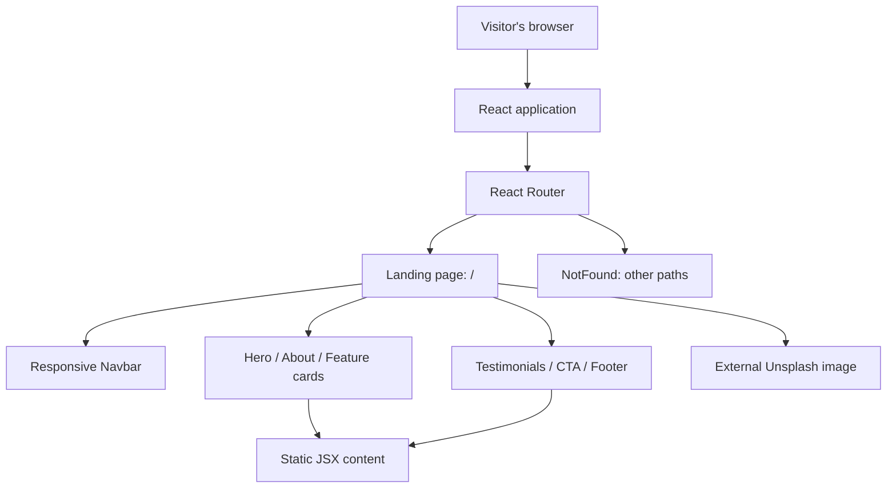

# KarangnongkoFarm — Digital Goat Farming Landing Page

**A responsive landing-page prototype introducing a village goat-farming digitalization initiative in Karangnongko, Klaten, Central Java, Indonesia.**

KarangnongkoFarm is a frontend design experiment developed in the context of a **Kuliah Kerja Nyata (KKN)** / community digitalization project. Its purpose is to communicate the idea of more organized goat-farm management to visitors: presenting the farm, introducing its two barn areas, and describing possible uses of technology in livestock operations.

Built with **React, TypeScript, Vite, and Tailwind CSS**, this repository contains a **public-facing promotional landing page**, not a livestock management system.

> [!IMPORTANT]
> **Prototype status.** The health-monitoring, feeding, birth-record, and sales-tracking items on the page are **feature descriptions only**. This repository does **not** implement those workflows, authentication, a database, a backend API, or live farm records. Testimonials and other promotional claims are hardcoded in the frontend; their real-world accuracy has not been independently verified.

## Overview

The landing page introduces a vision for applying digital tools to local goat farming. It focuses on explaining that vision in a simple, accessible format rather than implementing farm operations.

### Sections implemented

| Section | Content / behavior | Status |
| --- | --- | --- |
| Hero | Farm branding, introductory tagline, full-screen background image, and **Learn More** button | Static content; button scrolls to About |
| About | Overview of the digital-farming initiative and information cards for the **Western Barn** and **Eastern Barn** | Static content |
| Features | Cards describing **Animal Health**, **Feeding Schedule**, **Birth Records**, and **Sales Tracking** | **Illustrative concepts**, not working management modules |
| Testimonials | Three testimonial cards with quotes and names | Hardcoded sample content; not verified customer testimonials |
| Contact/CTA | Invitation to learn about the farm and a **See Our Farm** button | Display only; button has no linked action |
| Footer | Village, regency, province, and country text | Static content |
| Navigation | Section-based scrolling with desktop navigation and a mobile menu | Implemented |
| Missing routes | Catch-all page for unknown browser paths | Implemented |

### Site navigation

The navigation bar scrolls to sections on the single page:

```text
/                 Main landing page
  #home           Hero
  #about          Introduction and barn information
  #features       Proposed digitalization features
  #testimonials   Static testimonial cards
  #contact        Call to action

/*                NotFound page (React Router catch-all)
```

Section navigation uses `scrollIntoView({ behavior: "smooth" })` against DOM element IDs. It is not a multi-page content-management or farm-administration application.

## Design and user experience

The frontend uses an agriculture-inspired color palette and a responsive layout.

- **Visual direction:** green/tan farm-themed tokens, large typography, background imagery, rounded cards, and gradient sections.
- **Responsive navigation:** horizontal buttons on desktop and a toggleable menu on smaller screens.
- **Micro-interactions:** smooth section scrolling, hover styles, and a basic entrance animation on the hero.
- **Content structure:** introduction → farm context → proposed benefits → testimonials → final call to action.

The hero's background photograph is loaded from **Unsplash via an external URL** in `src/pages/Index.tsx`. No project-specific farm photography or screenshot set is stored in this repository.

## Technology stack

| Concern | Technologies |
| --- | --- |
| Frontend | React 18, TypeScript |
| Build/development | Vite 5, React SWC plugin |
| Styling | Tailwind CSS 3, CSS variables, PostCSS |
| UI components | Radix/shadcn-style components, Lucide React icons |
| Routing | React Router DOM 6 |
| Supporting providers | TanStack React Query, tooltips, toast/Sonner providers |
| Code quality | ESLint, TypeScript |

The application was originally scaffolded with **Lovable-related tooling**; `lovable-tagger` is registered during development. Some UI packages are present because of the starter scaffold and are not necessarily used by the actual landing page.

**Not included:** a server-side application, database, authentication, API endpoints, farm dashboard, payment system, or configured test runner.

## Architecture



The entire page is rendered from local frontend code. There are no API calls that fetch farm data, no persistent state for goat records, and no connection to the other Karangnongko repositories demonstrated here.

### Important source files

- [`src/pages/Index.tsx`](src/pages/Index.tsx): content, section layout, hero, proposed feature cards, testimonials, CTA, and footer.
- [`src/components/Navbar.tsx`](src/components/Navbar.tsx): desktop/mobile section navigation.
- [`src/App.tsx`](src/App.tsx): React Router routes and application-level providers.
- [`src/pages/NotFound.tsx`](src/pages/NotFound.tsx): catch-all route.
- [`tailwind.config.ts`](tailwind.config.ts): theme and styling configuration.
- [`index.html`](index.html): HTML entry and social/SEO metadata.

## Getting started

### Prerequisites

- Node.js version compatible with Vite 5.
- npm (a `package-lock.json` is included).
- A modern web browser.

### Clone and run

```bash
git clone https://github.com/alfrzhb/karangnongko-farm.git
cd karangnongko-farm
npm install
npm run dev
```

Vite is configured to start on **port 8080**. Open the URL shown in the terminal (normally `http://localhost:8080`).

No API keys, server credentials, or database are needed to view and interact with the landing page.

### Build and code quality

```bash
npm run build        # Production build → dist/
npm run preview      # Preview the production build
npm run lint         # Run ESLint
npm run build:dev    # Build in development mode
```

These commands exist in `package.json`. **They were not executed during this README-only audit**, so the current repository's build and lint status have not been verified.

There is **no configured `npm test` script** in the inspected package manifest.

## Project structure

```text
karangnongko-farm/
├── index.html                    # Document entry and metadata
├── package.json                  # Dependencies and scripts
├── package-lock.json             # npm lockfile
├── vite.config.ts                # Vite setup; dev port 8080
├── tailwind.config.ts            # Design tokens and utility settings
├── components.json               # UI component configuration
├── public/                       # Favicon and placeholder assets
└── src/
    ├── main.tsx                  # React entry point
    ├── App.tsx                   # Router and global providers
    ├── App.css
    ├── index.css                 # Tailwind layers and CSS variables
    ├── pages/
    │   ├── Index.tsx             # Entire landing page
    │   └── NotFound.tsx          # Fallback route
    ├── components/
    │   ├── Navbar.tsx            # Section navigation
    │   └── ui/                   # Shared UI primitives
    ├── hooks/                    # Mobile/toast hooks
    └── lib/
        └── utils.ts              # Class-name utilities
```

## Relationship to other Karangnongko projects

There are multiple repositories connected by **domain and project context**, but they are **not proven to be a single integrated system**.

| Repository | Role | What it currently represents |
| --- | --- | --- |
| **[karangnongko-farm](https://github.com/alfrzhb/karangnongko-farm)** (this repository) | Public landing page | React promotional and explanatory prototype; no farm-record API or storage |
| [karangnongko-goat-keeper](https://github.com/alfrzhb/karangnongko-goat-keeper) | Operational UI prototype | React frontend for login, dashboard, goat records, and feeding calendar; backend integration is not included |
| [sip_karangnongko](https://github.com/alfrzhb/sip_karangnongko) | Farm information system | Separate Laravel/Filament application documenting livestock management features |

Do **not** assume this landing page is connected to the goat-keeper prototype or Laravel system. The inspected source contains no shared API integration or verified deployment link between them.

## Limitations and recommended next steps

The following observations are about the **current code**, not features already delivered:

1. **Proposed features are illustrative.** Animal health, feeding, birth records, and sales tracking are displayed as informational cards. There are no corresponding input screens, records, workflows, or live data.
2. **Testimonials are static.** The page contains three hardcoded quotations/names without source evidence. Confirm permission and authenticity or replace them with clearly identified demonstration copy.
3. **CTA has no action.** The `See Our Farm` button is rendered without a click handler or link. Connect it to a real destination only after a relevant destination exists.
4. **Identity and farm details need verification.** Barn manager names and promotional statements are directly written into the frontend. Validate the wording before public publication.
5. **SEO and social previews remain boilerplate.** The HTML uses Lovable-generated descriptions, author metadata, and social images. Replace these with project-specific metadata before publishing.
6. **External assets and scripts.** The hero depends on a remote image; `index.html` also loads an external GPT Engineer script. Review external dependencies, privacy, and deployment requirements before production use.
7. **No tests or validated deployment.** There is no test command, verified production URL, or live farm-data integration documented in the repository.
8. **Accessibility and responsive QA remain necessary.** Audit focus management for the mobile menu, section navigation, color contrast, reduced-motion preferences, and mobile viewport behavior.

### Suggested evolution

- **If this remains a landing page:** validate public content, add authentic photos, make the CTA useful, improve SEO/accessibility, and deploy the static site.
- **If it becomes the public entry to a farm application:** link explicitly to the **actual** operational system after confirming its domain, authentication, and integration behavior.
- **If feature cards need real functionality:** implement and validate those operations in the correct application/backend rather than claiming that this promotional site already supports them.

## Deployment

This is a static React/Vite application. Deploy the contents of **`dist/`** after a successful `npm run build` using a host that supports single-page application fallback, especially for client-side routes handled by React Router.

No active production URL was verified in this audit.

## License

The repository includes an [Apache License 2.0](LICENSE) file. External photographs and third-party dependencies may carry separate rights and terms.

---

**Repository:** [alfrzhb/karangnongko-farm](https://github.com/alfrzhb/karangnongko-farm)

**Project category:** KKN-related digital farming **landing-page prototype**, not a verified production livestock management system.
